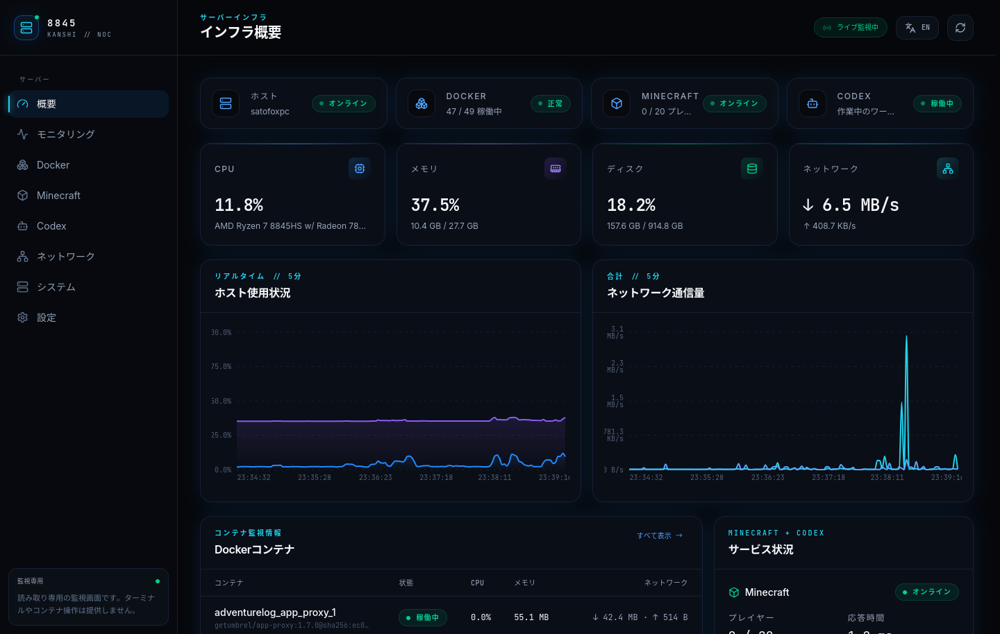
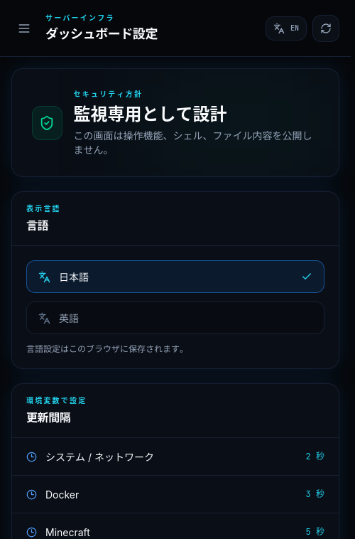

# 8845 KANSHI

A production-oriented, monitor-only web dashboard for an Ubuntu mini PC. It collects live host, Docker, Minecraft Java server, and Codex CLI telemetry without exposing shell access or infrastructure controls.

## Features

- Ubuntu host: CPU, per-core load, temperature, memory, swap, disk, uptime, kernel, and boot time
- Network: interface addresses, state, traffic totals, and real-time RX/TX rates; Docker bridges can be hidden
- Docker: container inventory, status, uptime, CPU, memory, network, block I/O, network/port metadata, and one-hour history
- Minecraft: online state, version, MOTD, latency, player count/names, avatars, and matching container resources
- Codex CLI: active/idle state, PID, CPU, memory, uptime, workspace, Git branch, and recent file metadata
- Responsive NOC interface with Skeleton loading, partial-failure states, polling, and Recharts history graphs
- Japanese and English interface with a persistent browser-side language switcher (Japanese is the default)

## Architecture

```text
Browser :3000
    │
    ▼
Nginx + React (host network, read-only)
    │ GET /api/*
    ▼
FastAPI :8000 (host PID/network, read-only mounts)
    ├── psutil ─────────────── Ubuntu host metrics
    ├── mcstatus ───────────── Minecraft status protocol
    ├── /proc + workspace ─── Codex process/file metadata
    └── Docker SDK ──────────► socket proxy :2375
                                  │ GET-only API allowlist
                                  ▼
                              Docker socket
```

The backend never mounts the Docker socket. `docker-socket-proxy` exposes only read endpoints for container metadata, stats, version, and ping; all Docker POST endpoints are disabled.

## Screenshots

### Desktop overview



### Smartphone settings (Japanese)



The UI also includes dedicated Monitoring, Docker detail, Minecraft, Codex, Network, System, and Settings views.

## Requirements

- Ubuntu or another Linux host with Docker Engine 24+
- Docker Compose v2
- Access to `/var/run/docker.sock` for the socket-proxy container
- Minecraft Java server reachable from the Ubuntu host (optional)
- Codex CLI running as the configured `PUID` (optional)

## Installation

```bash
git clone https://github.com/satoyoshiaki/8845kanshi.git
cd 8845kanshi
cp .env.example .env
docker compose up -d --build
```

Open `http://SERVER_IP:3000`. The backend listens only on `127.0.0.1:8000` by default and is proxied through the frontend.

The dashboard opens in Japanese by default. Use the language button in the top bar or the **Settings / 設定** page to switch between Japanese and English. The selection is stored only in the browser's `localStorage`.

## Configuration

Edit `.env` before starting:

```env
MINECRAFT_HOST=127.0.0.1
MINECRAFT_PORT=25565
MINECRAFT_CONTAINER_NAME=minecraft

HOST_HOSTNAME=ubuntu-server
MONITORED_MOUNTS=/
CODEX_WORKSPACE_ROOT=/home/your-user/projects
PUID=1000
PGID=1000
```

Use the host address that actually accepts Minecraft status connections. `MINECRAFT_CONTAINER_NAME` must be the Docker container that owns the Minecraft JVM; Crafty installations often use a container named `crafty`.

`CODEX_WORKSPACE_ROOT` is mounted read-only at the same absolute path. Codex file activity is restricted to this tree, scans only common source-file names, and returns paths plus modification timestamps—not file content.

To monitor additional host filesystems, list their mount points:

```env
MONITORED_MOUNTS=/,/mnt/storage
```

## Docker Compose

Start or rebuild:

```bash
docker compose up -d --build
```

Stop only this dashboard stack:

```bash
docker compose down
```

This Compose project uses explicit `kanshi-*` container names and does not join, modify, stop, or restart existing service containers.

View logs:

```bash
docker compose logs -f dashboard-backend dashboard-frontend
```

Check health:

```bash
docker compose ps
curl http://127.0.0.1:8000/api/health
curl http://127.0.0.1:3000/api/dashboard
```

## Ubuntu Monitoring

FastAPI uses `psutil`, the host PID namespace, host networking, and a read-only host-root mount. CPU and memory come from the host kernel. Disk usage is resolved below `/host` for only the mount points listed in `MONITORED_MOUNTS`. Missing sensor support returns `temperature_celsius: null`, rendered as **Unavailable**.

## Docker Monitoring

The backend connects to `tcp://127.0.0.1:2375`, where the socket proxy permits Docker `GET` requests for containers, stats, ping, info, and version. The browser never accesses the proxy or Docker socket. Container detail pages retain up to one hour of in-memory CPU and memory samples; history resets when the backend restarts.

## Minecraft Monitoring

`mcstatus` uses the standard Java server status and query protocols. If the server is stopped, unreachable, or hides its sample list, the rest of the backend continues normally. Query is attempted only when status reports online players without names.

## Codex Monitoring

Only OS-visible process metadata is exposed: PID, resource use, start time, working directory, Git repository/branch, and recently modified source-file paths. The API never returns process command lines, environment variables, prompts, conversation data, file content, or credentials.

## Security

- No arbitrary shell or command endpoint
- No Docker exec, start, stop, restart, delete, image, volume, or network actions
- Docker socket isolated behind a GET-only proxy bound to loopback
- Backend and frontend use read-only filesystems, dropped capabilities, and `no-new-privileges`
- Backend bound to loopback; frontend is the only LAN-facing service
- No secrets in frontend bundles or API responses
- `.env`, credentials, keys, logs, build artifacts, and dependency directories are ignored by Git

This dashboard has no authentication layer. Expose it only on a trusted LAN/VPN, or place it behind an authenticated reverse proxy. Do not publish port 3000 directly to the internet.

## API

Core endpoints:

```text
GET /api/dashboard
GET /api/system
GET /api/cpu
GET /api/memory
GET /api/disk
GET /api/network
GET /api/docker
GET /api/docker/{container}
GET /api/docker/{container}/history
GET /api/minecraft
GET /api/minecraft/players
GET /api/codex
GET /api/codex/process
GET /api/codex/workspace
GET /api/codex/activity
GET /api/history/{host|network|codex}
```

Interactive API docs are available locally at `http://127.0.0.1:8000/docs`.

## Troubleshooting

### Docker shows Unavailable

```bash
docker compose ps docker-socket-proxy
docker compose logs docker-socket-proxy dashboard-backend
curl http://127.0.0.1:2375/_ping
```

Confirm the user running Docker can mount `/var/run/docker.sock` and that port `2375` is unused.

### Minecraft shows Offline

- Confirm `MINECRAFT_HOST` and `MINECRAFT_PORT` from the Ubuntu host.
- If the port is bound only to WireGuard, use that host address (for example `10.200.0.2`) rather than `127.0.0.1`.
- Player names may remain unavailable when server sample/query is disabled; this is expected.

### Codex shows Idle or has no workspace

- Set `PUID` and `PGID` to the user running Codex (`id -u`, `id -g`).
- Set `CODEX_WORKSPACE_ROOT` to a parent directory of the active workspace.
- The process must be visible in the host PID namespace and owned by the configured user.

### Port conflict

Change `FRONTEND_PORT` or `BACKEND_PORT` in `.env`, then recreate only this stack:

```bash
docker compose up -d --build --force-recreate
```

## Development

Backend:

```bash
cd backend
python -m venv .venv
. .venv/bin/activate
pip install -r requirements.txt
uvicorn app.main:app --reload
```

Frontend:

```bash
cd frontend
npm install
npm run dev
```

Build and basic tests:

```bash
PYTHONPATH=backend python -m unittest discover -s backend/tests
npm --prefix frontend run build
docker compose config --quiet
```
